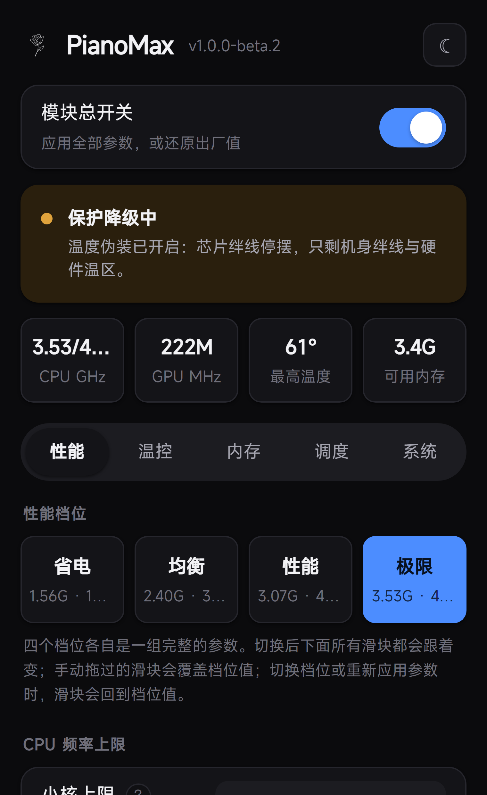
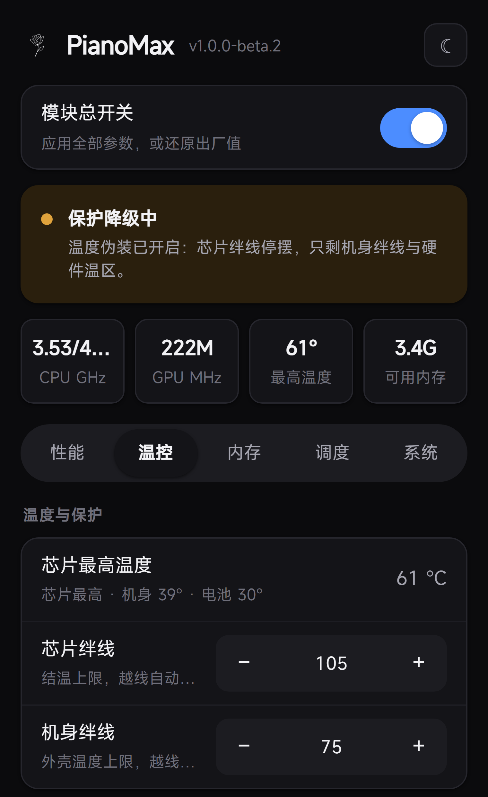
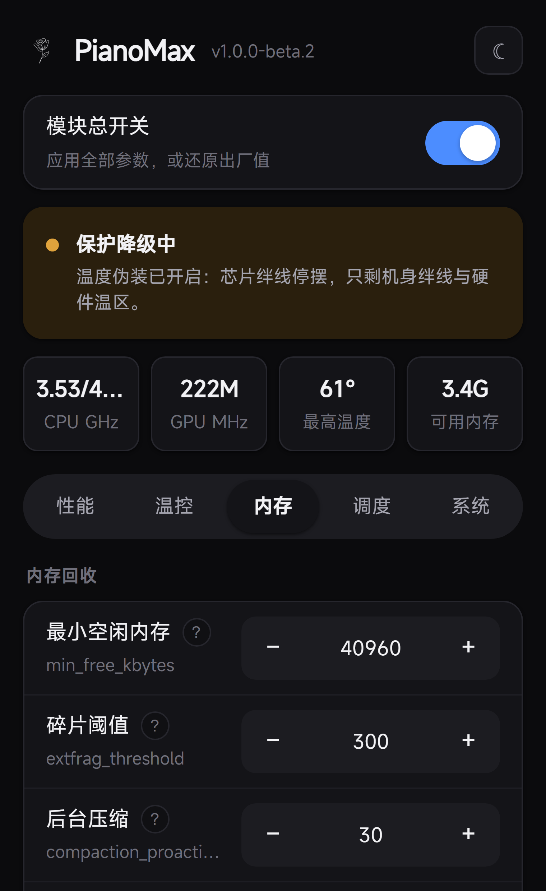
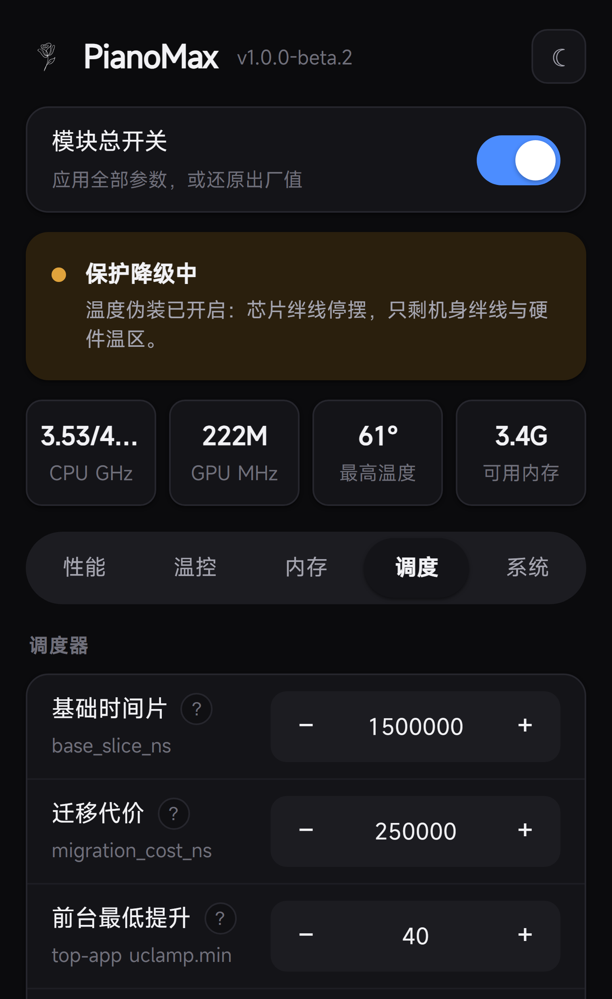
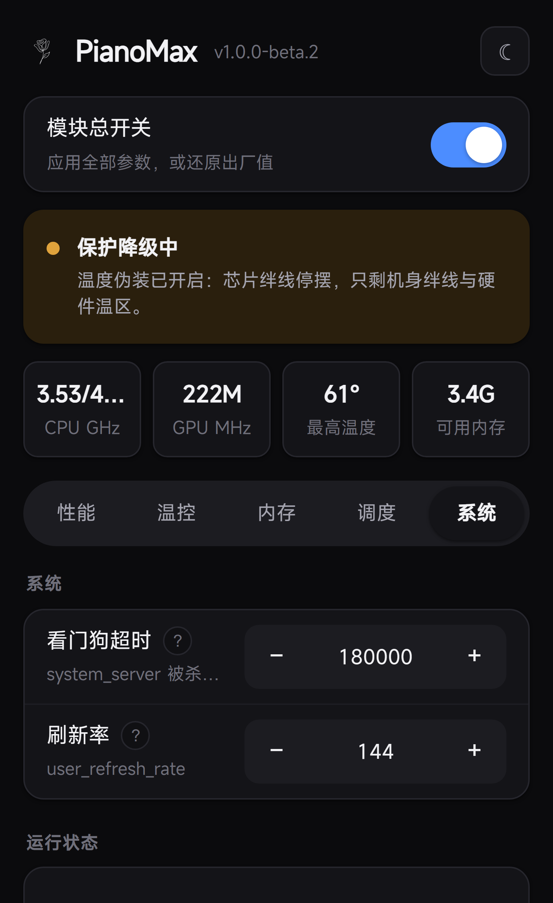

<div align="center">

<picture>
  <source media="(prefers-color-scheme: dark)" srcset="docs/logo-light.png">
  
</picture>

# PianoMax

[English](README.en.md) · 更新日志见 [CHANGELOG.md](CHANGELOG.md)


-orange?style=flat-square)


</div>

小米平板 8 Pro（piano / SM8750P）的 KernelSU 用户态频率调度模块。

提供省电 / 均衡 / 性能 / 极限四个档位，每个档位是一整套 CPU / GPU / 总线上限与两条温度绊线，切换即整体生效。常驻守护进程每秒恢复被系统压低的上限。电池、充电、BCL 电流与 PMIC 结温等硬件保护温区始终保留原厂读数与保护；另有一个**默认关闭**的温度伪装档位（四选一，从「仅框架锁」到「极致」），档位越高越多计算温区读数被伪造，各档失去哪些保护见下文「温度伪装」一节。

> [!WARNING]
> 仅支持小米平板 8 Pro（piano / SM8750P）。脚本内置设备检查，其他机型安装后不会生效，也不会改动任何系统参数。
> 从 beta 升级前请先在模块管理中移除旧版再安装新版；跨版本直接覆盖未经测试。

## 下载

<div align="center">

[](https://github.com/ylx9000/PianoMax/releases/download/v1.0.0-beta.2/PianoMax-v1.0.0-beta.2.zip)

</div>

链接指向本版发布的资产包。安装：KernelSU 管理器 → 模块 → 从本地安装 → 选择 zip（不要解压或改名）→ 重启。历史版本见 [Releases](https://github.com/ylx9000/PianoMax/releases)。

## 四个档位

每次切换应用一整套参数；切换后仍可单独调节滑块，切换档位或重新应用参数会把滑块写回档位值。

| 档位 | 小核 | 大核 | GPU 上限 | DDR | LLCC | 芯片绊线 | 机身绊线 | 软温控 |
| --- | --- | --- | --- | --- | --- | --- | --- | --- |
| 省电 | 1555200 | 1958400 | 389 MHz | 1353000 | 533000 | 90 °C | 50 °C | 交还内核 |
| 均衡 | 2400000 | 2841600 | 660 MHz | 3187000 | 933000 | 100 °C | 55 °C | 模块接管 |
| 性能 | 3072000 | 3513600 | 832 MHz | 4224000 | 1066000 | 105 °C | 62 °C | 模块接管 |
| 极限 | 3532800 | 4320000 | 1100 MHz | 4761000 | 1211000 | 105 °C | 75 °C | 模块接管 |

- 所有频率在写入前对齐到内核实际提供的频点阶梯。阶梯之外的数值会被内核静默取整，导致界面显示值与模块请求值不一致。
- **省电**档将软温控交还内核：该频率下原厂调频曲线不会触发降频，禁用它只会移除一层保护。
- 档位与滑块写入同一组状态文件，两者不存在第二套配置，显示值与生效值始终一致。
- 档位切换时芯片仍带有上一档位的余热，可能立即触到新的、更低的绊线。因此切换后有 15 秒宽限：期间照常维持上限但不触发降档，待热状态稳定后再按新档位判定。
- GPU 一列为**上限值**：GPU 由 msm-adreno-tz 按需调频，空载时自动降至低频属于正常行为。上限是否生效以 WebUI 系统页的 GPU 硬顶读数为准。

也可通过命令行切换：`sh /data/adb/modules/pianomax/profile.sh powersave|balanced|performance|extreme`，`profile.sh list` 查看全部。

## 与其他模块同装（重要）

PianoMax 会写这些节点：`cpu_limits`、`scaling_max_freq`、`scaling_governor`、thermal zone `mode`、GPU pwrlevel 与 cooling device、DDR / LLCC `min_freq`、调度器（sched / walt）参数、内存参数（min_free / extfrag / compaction）、I/O 参数。**任何写入同一批节点的模块都会与之冲突**，实际表现：

| 冲突模块类型 | 典型改动 | 冲突表现 |
| --- | --- | --- |
| 性能守护类（各类「游戏加速」「性能模式」模块） | 同样写入 cpu_limits / scaling_max_freq，或自带频率守护 | 双方守护互相覆盖：一方抬升一方压低，频率反复波动，读数与真实负载不对应 |
| 温控屏蔽类（「解除温控」类脚本） | 将电池 / 充电 / BCL 温区也设为 disabled | PianoMax 有意保留硬件保护温区；此类脚本将其关闭后，过温仅剩内核 critical trip 一道防线，PMIC 过温将直接黑屏关机 |
| mi_thermald 灭杀类 | 以空脚本替换或终止 mi_thermald | 本机 tsens 为电平触发中断，无人清除中断状态时 CPU 每秒响应数千次中断，整机卡死。PianoMax 的策略是与该守护进程竞争而非终止它，对方终止后双方均受影响 |
| GPU 锁频类 | 开机一次性写入 thermal_pwrlevel / max_pwrlevel | msm-adreno-tz 会重新锁存，一次性写入数秒内失效；与 PianoMax 同时写入时锁存状态不可预期 |
| 调度器调参类（sched / walt / uclamp 模块） | 写入同名节点 | 同节点双写以后写者为准；双方 UI 显示值都可能偏离实际生效值 |
| 内存参数类（min_free_kbytes / LRU 调优） | 写入同一批 /proc 节点 | 双写互相覆盖，最终行为取决于模块启动顺序 |

结论：请将 PianoMax 作为唯一的性能模块使用。上述任何类型与其共存均无法获得叠加效果，只会使双方的日志与读数失去可信度。确需共存时，请先在对方模块中关闭频率 / 温控部分，仅保留不重叠的功能。

## 参数

| 单元 | 值 | 说明 |
| --- | --- | --- |
| CPU 小核 | 3532800 kHz | policy0，6 核，16 档 |
| CPU 大核 | 4320000 kHz | policy6，2 核，16 档 |
| GPU | 1100 MHz | 需要 thermal_pwrlevel 为 0 |
| DDR | 4761000 kHz | memlat 与 bwmon 投票 |
| LLCC | 1211000 kHz | memlat 与 bwmon 投票 |

## 温度伪装（默认关闭 · 四档）

WebUI 温控页有四个档位，默认「关闭」。档位之间不是程度差异，而是**有多少传感器不再说真话**——所以它被做成四选一而不是一个开关。

| 档位 | 做什么 | 温区 | 仍然真实的传感器 |
| --- | --- | --- | --- |
| 关闭 | 不碰任何节点，同时解除框架锁 | 0 | 全部 57 |
| 仅框架锁 | `cmd thermalservice override-status 0`，只锁框架热状态 | 0 | 全部 57 |
| 普通 | 框架锁 + CPU/GPU 簇写 25 °C | 28 | 29（DSP、存储、摄像头、视频、PMIC 结温；机身族温区不在伪装范围内，同样保持真实） |
| 极致 | 框架锁 + 全部可伪装温区写 25 °C | 48 | 9（8 个 PMIC 结温 + 电池） |

两层机制：

| 层 | 通道 | 说明 |
| --- | --- | --- |
| 框架层 | `cmd thermalservice override-status 0` | 游戏内降画质判定、Unity Adaptive Performance、`PowerManager.getThermalStatus` 走的都是这一层。**内核 governor 与 mi_thermald 完全不受影响** |
| 内核层 | 计算温区 `emul_temp` 写 25000 | 只影响读 `thermal_zone*/temp` 的读者。`emul_temp` 是只写节点（0200，无 show 句柄），写入后无法回读，效果通过温区温度验证 |

**任何档位下都不会伪装的**：电池、充电、BCL 电流限制、PMIC 结温（69–76，8 个）、无线充电（77），以及机身绊线读取的那 10 个离散温区——**57 58 59 60 63 64 65 66 67 68**。不是 57–68 连续区间：61 与 62 不在机身绊线集合内（62 是 cpu_therm，属于可伪装的计算温区，极致档下它读 25 °C）。硬件过温保护与内核 critical trip 照常工作。

**分档的实际意义**：极致档把 48 个温区全部遮住后，模块自身的芯片绊线只剩 8 个 PMIC 结温加电池这 9 个真实输入可用。实测这 9 个里只有 `pmih010x_lite_tz`（本机 zone 71）明显偏高，其余都在 30 多 °C，而芯片绊线阈值是 105 °C。也就是说这一步不是"阈值还高"，而是**输入已经不够了**：57 个绊线输入里有 48 个被遮住，剩下的 9 个没有一个会接近阈值。

普通档只遮 28 个，57 个硅传感器输入剩 29 个真实读数，芯片绊线照常工作。这是"普通比极致安全"从说法变成事实的地方。

**对 mi_thermald 的实际影响**：它的 VIRTUAL-SENSOR 决策输入聚合了 cpu_therm（权重 8），而 cpu_therm 是可伪装温区——实测 thermal.dump 中，emul 开启时该聚合输入恒为 25000。也就是说换表之外，伪装本身也会轻微影响守护进程的输入侧。它的其余输入（quiet_therm 与机身族）不受影响，且换表后守护进程本来就在执行我们设定的上限，因此这一项是已知且可接受的副作用，但「mi_thermald 完全不受伪装影响」这个说法不成立。

开启 emul 的档位会同时把机身绊线收紧 3 °C，因为芯片侧已经不可靠，机身是唯一还活着的软保护。WebUI 的温度卡显示真实最高温，CPU/GPU 两个字段在被遮住时显示 `—`。

省电档把软温控交还内核，此时任何 emul 档位都会自动降级为「仅框架锁」并记一行日志——否则等于伪造读数让刚被交还的 governor 失明。界面徽标会如实显示降级后的实际行为（「仅框架锁」），而不是你选择的档位名——状态与行为始终一致。

**开关切换是幂等的**：从极致降到普通会清掉多出来的 21 个温区，降到关闭会解除框架锁。关闭模块（还原出厂值）同样会解除框架锁——这一步曾遗漏，导致关掉模块后框架仍然认为设备处于「正常」热状态。

## 四条通道，不是一条

这是理解本模块工作方式的关键。

**1. cpu_limits 是命令通道。** `/sys/devices/virtual/thermal/thermal_message/cpu_limits` 读取始终为空，但写入即为频率天花板。写 `scaling_max_freq` 会在两秒内被 `mi_thermald` 覆盖，写 cpu_limits 不会。

**2. 温区 disabled 仅作用于内核。** 将计算温区设为 `disabled` 停止的是内核 thermal governor 抬升 cooling device 的动作；`mi_thermald` 是用户态守护进程，直接写 cpu_limits，与温区开关完全无关。因此仅关闭温区并不足够，需要守护进程维持上限。

**3. 守护进程是第三条。** `guard.sh` 每秒读取实际上限，低于设定值即重写 cpu_limits。其作用不是加速，而是维持上限——没有这一步，关闭温区后频率仍会滑落至 1.9 GHz。实测：无守护时 20 秒内由 3532800 滑落至 1785600；有守护时稳定在设定值附近。

**4. 换掉热表是第四条。** `mi_thermald` 的降频决策来自一张 AES 加密的温控表，不在 `/vendor/etc` 而在 `/odm/etc`。模块在 `lib/thermal.sh` 里解密、替换、重载——前三条通道是在系统已经降频之后抢救，这条是让系统从一开始就不按原曲线降。详见「热表替换」一节。

## 热表替换

`mi_thermald` 是用户态守护进程，它的降频决策来自一张加密的温控策略表。这张表**不在 `/vendor/etc`，在 `/odm/etc`**；进程启动时读一次，之后一直按它执行。

这就是为什么单纯顶回频率会很累：你在跟一个每秒按自己表重写节点的进程赛跑。所以模块采取另一条路——**把表换掉**，让守护进程替我们干活。

| 项 | 值 |
| --- | --- |
| 原厂表位置 | `/odm/etc/thermal*.conf`（49 张，覆盖不同场景） |
| 部署位置 | `/data/vendor/thermal/config/` |
| 加密 | AES-128-CBC，key = IV = `thermalopenssl.h` |
| 生效方式 | 覆盖文件后重启守护进程（`setprop ctl.restart mi_thermald`） |
| 配置目录权限 | `0771 root:system`，写我们自己的表前先 `chattr -i`，写完再 `+i` 防云端改回 |

模块内的 `thermal/` 目录预置了三张表，分别对应均衡 / 性能 / 极限三个预设（省电档不换表，它把温控交还内核）。切换预设即换表并重启守护进程，策略真空期 1–2 秒，守护进程会在这期间重新顶回上限。

### 场景表与我们的表并存

实测（2026-10-22）：这张表有**场景维度**。`/sys/class/thermal/thermal_message/sconfig` 是场景号（-1 默认），写 1 后守护进程立刻重载 `thermal-cgame.conf`（游戏表），写回 -1 重载 `thermal-normal.conf`——`decrypt.txt` 的纳秒 mtime 在两次切换时都变了。这意味着：

- **游戏进行中跑的是原厂游戏表，不是模块的极限表**。厂商的游戏温控表为高负载场景特调，这是合理行为，模块不做干预；
- 我们的表只占 `thermal-normal.conf` 一个文件位，daemon 只读不写，场景切换**永远不会覆盖或污染**它——游戏退出即回到极限表的管控；
- 剩余 48 张场景表保持原厂（cgame / boost / camera / 4k 等），模块只动 normal 位。

### 还原与它的坑

首次换表前，模块会把 `/odm/etc` 里的原厂表快照到 `.thermal_orig/`，`restore` 与卸载时还原。**这个快照曾经从错误的目录抓取**：早先的实现从 `/data/vendor/thermal/config` 抓，而那个目录正是我们的表被放进去的地方——于是任何一次换表之后再抓，都会把我们自己的表当成原厂表存下来，`revert` 再忠实地把它「还原」回去。现在 capture 优先读 `/odm/etc`，并跳过任何与模块内预设表逐字节相同的文件。

### 怎么确认它生效了

守护进程每次加载表都会重写 `/data/vendor/thermal/decrypt.txt`（内容是它最后加载的那张表的明文），mtime 精确到纳秒。换表后模块轮询这个时间戳，变了才认为换表成功，并记一行日志：

```
thermal: daemon reloaded (table extreme stamped)
```

没变则记 `thermal: no reload detected after restart`。这只是一种降级——表已经物理就位，只是没能确认守护进程重读；此时守护进程的频率顶回逻辑仍然照常工作。

`piano_diag.sh` 会核对 `.thermal_mode`（模块认为当前是哪张表）与实际部署文件的 md5 是否一致。
## 温度策略

计算温区（CPU、GPU、板级传感器）切换为 `disabled`，内核不再因这些读数降频。电池、充电、BCL 电流限制与 PMIC 结温传感器**全部保留原状**，`mi_thermald` 继续运行。

守护进程盯着两组**互相独立**的传感器，因为它们的量级完全不同，合成一个阈值必然失效：

| 组 | 传感器 | 绊线（按档位） | 说明 |
| --- | --- | --- | --- |
| 芯片 | CPU 各簇、GPU、PMIC 结温 | 90 / 100 / 105 °C | 满载稳态就在 90-105，关机点约 110 |
| 机身 | quiet_therm、电池、充电、面板 | 50 / 55 / 62 / 75 °C | 关系到手感与电池寿命 |

越线后**并非一次性全部还原**，而是分级降档：先降至基准的 88%，仍过热再降至 78%，第三级才整体还原并暂停上限维持。温度回落并保持两分钟后，每两分钟自动升回一级。

「频率恒定保持上限」与「温度永不越过绊线」在物理上无法同时成立——一次性还原只会使模块每分钟振荡一次。

**为什么不停用 mi_thermald**：本机 tsens 为电平触发中断，该守护进程停止后无人清除中断状态，CPU 将持续响应同一中断（每秒数千次），最终拖垮整个系统。模块仅负责确保其运行，从不终止它。

**关于 emul_temp**：温度伪装是独立于上面这一切的开关，默认关闭，分四档。它遮住的是「谁在看温度」而不是硬件本身——PMIC 结温、机身族与内核 critical trip 从不参与伪装。各档失去哪些保护见「温度伪装」一节。

## 安装

```
KernelSU → 模块 → 从本地安装 → 选择下载到的 zip（文件名带版本号，不要解压或改名）→ 重启
```

要求：设备代号 `piano`（小米平板 8 Pro / SM8750P），Android 16 / HyperOS 3，KernelSU。脚本内置设备检查，其他机型直接退出。

## 使用

在模块卡片上通过动作按钮切换开启 / 关闭；WebUI 提供细粒度调节。

命令行：

```sh
su -c "sh /data/adb/modules/pianomax/tune.sh status"
su -c "sh /data/adb/modules/pianomax/tune.sh apply"
su -c "sh /data/adb/modules/pianomax/tune.sh restore"
su -c "sh /data/adb/modules/pianomax/profile.sh list"
```

## WebUI

<p align="center">
<picture>
  <source media="(prefers-color-scheme: light)" srcset="docs/shots/perf-light.png">
  
</picture>
<picture>
  <source media="(prefers-color-scheme: light)" srcset="docs/shots/thermal-light.png">
  
</picture>
</p>
<p align="center">



</p>

从 KernelSU 模块卡片打开。五个页签：性能、温控、内存、调度、系统。

设计上有四个刻意的选择：

**单次调用获取全部状态。** 页面每几秒调用一次 `control.sh snapshot`，单个进程取回 65 个值（轻量轮询 48 个），而非每个控件各发一条命令。

**写入必须回读确认。** 每个值均经 `control.sh set`，含白名单校验、范围检查与写入回读。被修改的行会显示「已生效」「被钳制」或「未写入」，不会无条件提示已写入。

**顶部先给结论。** 状态条并非装饰：正常运行 / 接近绊线 / 过温还原 / 守护未运行 / 上限未生效。守护停止意味着没有进程维持频率，这比任何数值都重要。

**两条绊线独立调节。** 芯片与机身是两条独立曲线，界面各有一个步进器，取值范围互不相同。

**每个参数都有「?」说明卡。** 参数行旁的小按钮点开一张底部弹层：第一句是人话结论，下面 2-4 条要点说明这个参数是什么、动了会怎样——长解释不堆在页面上，随暗色主题自动适配。

**日志页可过滤、可实时。** 内置日志查看器支持按级别切片（全部 / 操作 / 降档 / 伪装 / 异常），可开 2 秒实时尾随；模块日志本身记录完整决策链：每次降档带当时温度与目标值，WebUI 的每次写入都落一行 `ui-action` 审计。

**轮询成本已实测压到最低。** 稳态轮询走轻量快照（462 ms），改参数后才拉一次全量快照同步滑块；相比最初实现（1989 ms）每次轮询成本降约 77%。

## GPU 锁存机制（实测）

GPU 上限不是由 `max_pwrlevel` 决定的，而是被一个热冷却设备锁存：

```
/sys/class/thermal/cooling_device37  type=gpu  cur_state=4   # 本机 37；36 是 panel0-backlight。编号跨内核不稳定，务必按 type 查找
  → thermal_pwrlevel=4
  → max_gpuclk=832000000
```

此状态下写 `thermal_pwrlevel`、`max_pwrlevel`、`max_gpuclk` 均静默失效（返回 0，值不变）。唯一有效的做法是先将 `cooling_device*/cur_state`（按 `type=gpu` 查找，编号跨内核不稳定）写 0，再写 `devfreq/max_freq`。

实测：`cur_state 6 → 0` 使 `max_gpuclk` 从 660 MHz 恢复 1100 MHz，`clock_mhz` 随即到达 1100。守护进程每轮检查该锁存，被重新锁上即再次释放。

## 常见问题

**续航影响多大？** 极限档满频待机功耗比默认高约 1-2 倍，省电 / 均衡档接近原厂水平。建议安装后先使用均衡档，按需升档。

**是否关闭了系统温控？** 仅停用了「计算类」温区的内核调节器；电池、充电、BCL、PMIC 等硬件保护温区全部保留，mi_thermald 持续运行。温度伪装是独立的四档开关，默认关闭，关闭时不碰任何节点。

**为什么 GPU 显示 389 MHz？** 空载状态。GPU 有独立的按需调频，负载到来才升至上限。以 max_gpuclk 与 max_pwrlevel 判断上限是否生效。

**另一个性能模块同时运行时以谁为准？** 以最后写入节点的一方为准，双方都会显示各自期望的值。参见上一节，不建议并存。

**升级后档位名称变化？** beta 的档位名已更换为省电 / 均衡 / 性能 / 极限。旧配置自动识别，选择一次新档位即完成迁移。

## 已知限制

- GPU 锁存可能随时被 `msm-adreno-tz` 重新锁上。释放有效但会再次锁存，守护进程每秒检查一次；刚锁存后的数秒内读数短暂偏低。
- 极限档持续满载约 4-8 秒硅温到达 105 °C 绊线并自动降档——这是物理约束，不是缺陷；长时间满载建议使用性能档。
- 8 GB 内存运行重度内存测试仍可能触发内核 OOM。桌面与 SystemUI 有 `oom_score_adj` 保护不会被选中，后台进程可能被回收。
- 满频功耗显著上升，建议使用原装充电器。

## 开发

```sh
bash build.sh    # 打包到 release/PianoMax-<version>.zip（同时生成稳定名 PianoMax.zip）
```

模块结构：

```
module/
  module.prop
  post-fs-data.sh     冷启动 GPU 窗口
  service.sh          开机后应用一次
  boot-completed.sh   守护进程自愈
  tune.sh             apply / restore / status 入口
  restore.sh          还原出厂值
  guard.sh            守护进程
  status.sh           一次取回全部状态
  piano_diag.sh       一键体检（只读，八节诊断）
  action.sh           模块卡片的按钮
  uninstall.sh
  customize.sh
  lib/common.sh       路径、日志、写入计数
  lib/apply.sh        全部调参写入（tune 与 guard 共用一份）
  lib/thermal.sh      mi_thermald 加密热表替换（见「第四条通道」）
  lib/export.sh       状态导出
  profile.sh          预设切换
  presets.txt         四个预设的唯一真值表
  thermal/            各预设的热表（balanced / performance / extreme）
  webroot/
    index.html
    control.sh        WebUI 的唯一控制面
```

## 许可

PolyForm Noncommercial License 1.0.0（[LICENSE](LICENSE)）。个人学习、研究、自用等非商业目的可自由使用、修改与再分发；未经作者另行书面授权不得用于任何商业目的（含付费 ROM、商业模块合集）。Required Notice: Copyright (c) 2026 ylx9000。

## 免责声明

刷入前请完整阅读 [DISCLAIMER.md](DISCLAIMER.md)。简单说：这会把设备跑在温度和功耗都很高的工作点上，损坏风险由使用者承担。
